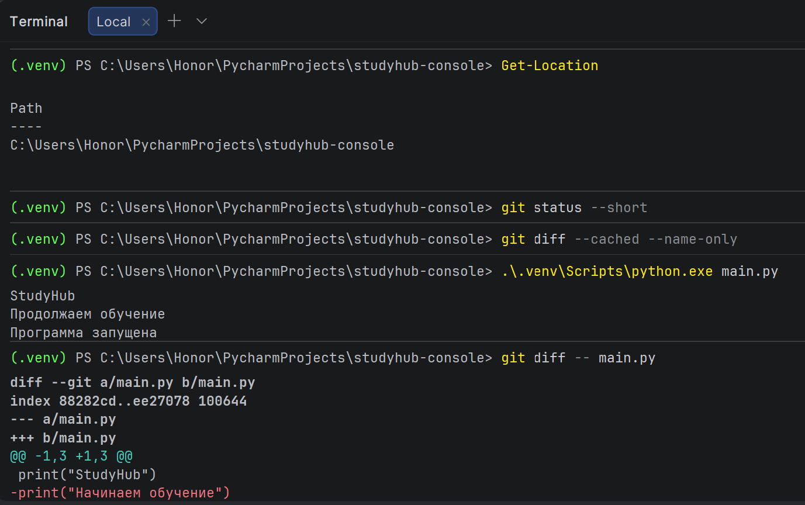
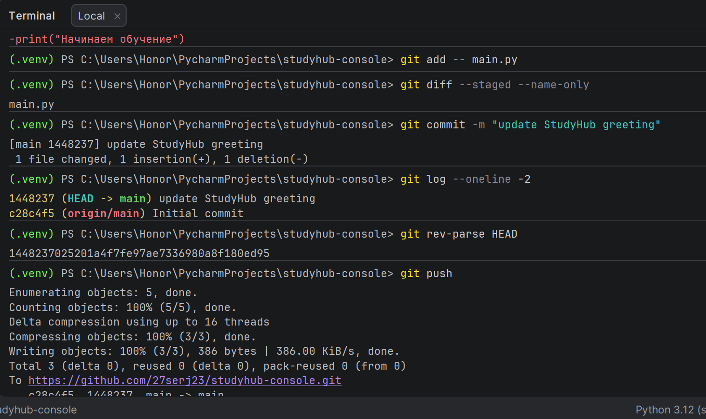
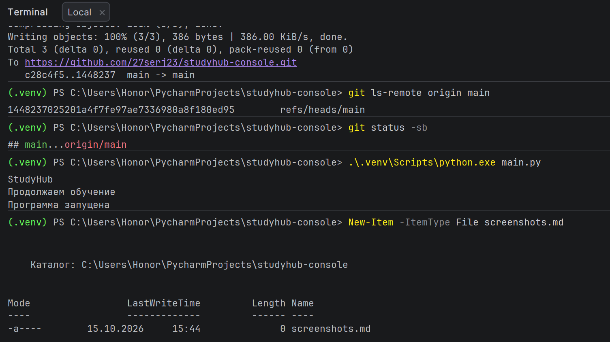

# Отчёт по задаче 2. Вторая рабочая правка

Проект: studyhub-console
Репозиторий: https://github.com/27serj23/studyhub-console
Ветка: main
Дата: 2026-10-15

---

## 1. Что сделано

В файле `main.py` изменена вторая строка приветствия:

- Было: `print("Начинаем обучение")`
- Стало: `print("Продолжаем обучение")`

Итоговое содержимое `main.py`:

```python
print("StudyHub")
print("Продолжаем обучение")
print("Программа запущена")
```

---

## 2. Проверка запуска

Запуск выполнен через интерпретатор из виртуального окружения:

```powershell
.\.venv\Scripts\python.exe main.py
```

Вывод:

```
StudyHub
Продолжаем обучение
Программа запущена
```

Скриншот:



---

## 3. Проверка рабочего diff

Перед добавлением в индекс проверено, что изменён только `main.py`:

```powershell
git diff -- main.py
```

Результат — одна замена во второй строке:

```diff
diff --git a/main.py b/main.py
index 88282cd..ee27078 100644
--- a/main.py
+++ b/main.py
@@ -1,3 +1,3 @@
 print("StudyHub")
-print("Начинаем обучение")
+print("Продолжаем обучение")
 print("Программа запущена")
```

---

## 4. Подготовка и staged diff

Файл добавлен в индекс строго по имени:

```powershell
git add -- main.py
```

Двойной контроль — в индексе должен быть только `main.py`:

```powershell
git diff --staged --name-only
```

Вывод:

```
main.py
```

**Скриншот:**



---

## 5. Новый коммит

Создан коммит с сообщением:

```powershell
git commit -m "update StudyHub greeting"
```

Вывод:

```
[main 1448237] update StudyHub greeting
 1 file changed, 1 insertion(+), 1 deletion(-)
```

Локальная история после коммита:

```powershell
git log --oneline -2
```

```
1448237 (HEAD -> main) update StudyHub greeting
c28c4f5 (origin/main) Initial commit
```

Новый коммит `1448237` продолжает историю первого коммита `c28c4f5`. Повторный `git init` и `git remote add` не потребовались.

Скриншот:



---

## 6. Сверка SHA до и после push

### До push

Локальный HEAD и удалённая ссылка `origin/main` различались:

```
git rev-parse HEAD        → 1448237025201a4f7fe97ae7336980a8f180ed95
git ls-remote origin main → c28c4f5d46a590c8362d0c68d4dc58e248d71800  (старый коммит)
```

GitHub показывал предыдущую версию `main.py` со строкой `Начинаем обучение`.

### Push

```powershell
git push
```

```
To https://github.com/27serj23/studyhub-console.git
   c28c4f5..1448237  main -> main
```

Диапазон `c28c4f5..1448237` явно показывает переход с прежнего коммита на новый.

### После push

```powershell
git rev-parse HEAD
```

```
1448237025201a4f7fe97ae7336980a8f180ed95
```

```powershell
git ls-remote origin main
```

```
1448237025201a4f7fe97ae7336980a8f180ed95        refs/heads/main
```

✅ Полные идентификаторы совпадают до последнего символа.

Синхронизация ветки:

```powershell
git status -sb
```

```
## main...origin/main
```

Без пометок `ahead` / `behind` — локальная и удалённая ветки идентичны.

---

## 7. Проверка сохранности окружения, ветки и origin

Файлы в индексе (что отслеживает Git):

```powershell
git ls-files
```

```
.gitignore
main.py
screenshots/img.png
screenshots/img_1.png
screenshots/img_2.png
```

Локальное присутствие `.venv`:

```powershell
Test-Path .venv
```

```
True
```

Удалённый репозиторий:

```powershell
git remote -v
```

```
origin  https://github.com/27serj23/studyhub-console.git (fetch)
origin  https://github.com/27serj23/studyhub-console.git (push)
```

Ветка:

```powershell
git branch
```

```
* main
```

`.gitignore`, `.venv`, ветка `main` и `origin` сохранены без изменений.

---

## 8. Подтверждение на GitHub

Открыт репозиторий https://github.com/27serj23/studyhub-console:

- в истории коммитов виден `update StudyHub greeting` (сокращённый SHA `1448237`);
- ниже — `Initial commit` (`c28c4f5`) — первый коммит сохранён;
- в файле `main.py` вторая строка содержит `print("Продолжаем обучение")`;
- папка `screenshots/` содержит три файла: `img.png`, `img_1.png`, `img_2.png`.

Скриншоты:


---

## 9. Самопроверка по критериям готовности

| Критерий | Чем подтверждено |

| Новый `main.py` печатает три строки | запуск `.\.venv\Scripts\python.exe main.py` |
| `git diff --staged --name-only` показывает только `main.py` | вывод команды |
| Новый коммит продолжает прежнюю историю | `git log --oneline -2` |
| Первый коммит остаётся доступным | `c28c4f5 Initial commit` в истории |
| `.gitignore`, `.venv`, ветка, `origin` не тронуты | `git ls-files`, `Test-Path .venv`, `git remote -v`, `git branch` |
| До push на GitHub видна предыдущая версия | `c28c4f5d46a590c8362d0c68d4dc58e248d71800 (origin/main)` в логе до push |
| После push полный ID совпадает | `rev-parse HEAD` == `ls-remote origin main` |
| Изменённая строка `main.py` видна на GitHub | raw-файл репозитория |

---

## 10. Итог

Задача 2 выполнена полностью:

- вторая строка `main.py` изменена на `print("Продолжаем обучение")`;
- запуск через интерпретатор из `.venv` подтверждён;
- создан коммит `1448237 update StudyHub greeting`, продолжающий первую историю;
- коммит отправлен в тот же репозиторий и ветку `main`;
- полный SHA локального и удалённого коммитов совпадает;
- содержимое `main.py` на GitHub соответствует локальной версии;
- `.gitignore`, `.venv`, ветка `main` и `origin` сохранены.

Первая публикация (коммит `c28c4f5 Initial commit`) сохранена, вся история линейная и непрерывная.